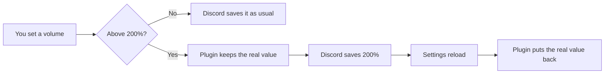

# 🎚️ Better Volume

Set a user's call volume with + and - buttons or by typing a number, and go above Discord's 200% limit.

---

## 💡 Why it exists

Discord's volume slider is hard to set precisely on a phone, and it stops at 200%. Some people are simply too quiet. Better Volume adds exact controls under the slider and lets you go further.

## ✨ Usage

Open the profile of someone in your call. Under Discord's volume slider there is a new row:

| Control | What it does |
|---|---|
| **-** and **+** | Lower or raise the volume by one step (5% by default). |
| **Number field** | Tap it and type the exact volume. It is applied when you leave the field, so half-typed numbers never reach the call. |

Discord's own slider also goes up to your maximum volume now.

In **Settings > Valenced > Plugins > Better Volume** you can change:

| Setting | Default | What it does |
|---|---|---|
| Maximum volume | `1000%` | The highest volume you can set (from 200% to 100000%). |
| Button step | `5%` | How much each + and - press changes the volume. |

> ⚠️ Very high volumes are extremely loud and can distort the audio or hurt your hearing. Lower your phone volume before trying them.

## 🧠 How it works

<b>🔧 Technical details</b>

- The row is added to Discord's `UserProfileVoiceSettings` by wrapping its component and inserting the new row after the element with the key `set-volume`. The same element's slider limit is raised.
- Volumes are set through Discord's own `setLocalVolume` action, using the same percent curve as Discord's slider.
- Discord only syncs volumes up to 200% to your account. Higher volumes are kept in the plugin's storage by patching `updatePendingSettings`, and are dispatched again after `USER_SETTINGS_PROTO_UPDATE` and `POST_CONNECTION_OPEN`.
- Only normal user volume is handled, not stream volume.
- Turning the plugin off removes the patches and listeners. Discord's slider and settings go back to normal.

## ⚠️ Limitations

- **Only for other users in a call.** Your own profile has no volume slider.
- **Stream volume is not changed.** It keeps Discord's 200% limit.
- **Very high volumes may be limited or distorted by your device or by Discord's audio engine.**
- **Major updates may require a plugin update.** The plugin depends on internal Discord modules (`UserProfileVoiceSettings`, `AudioSettingsPending`, `AudioActionCreators`, `MediaEngineStore`).

## 🗂️ Project files

| File | Purpose |
|---|---|
| `manifest.json` | Plugin identity: ID, version, author and dependencies |
| `js/index.tsx` | Plugin entry |
| `js/profileControls.tsx` | Adds the row to the profile and raises the slider limit |
| `js/VolumeControls.tsx` | The - / number / + row |
| `js/NumberInput.tsx` | Number field that applies its value when you finish typing |
| `js/volumeSync.ts` | Keeps volumes above 200% across restarts and settings syncs |
| `js/mediaEngine.ts` | Typed access to Discord's volume store |
| `js/settings.ts` | Settings, storage and volume conversion |
| `js/SettingsComponent.tsx` | The plugin's settings screen |
| `NOTICE` | Credits to the original plugin |
| `tsconfig.json` | Type-checking configuration |

## 🏷️ Plugin information

| Field | Value |
|---|---|
| ID | `axonyum.better-volume` |
| Version | `1.0.0` |
| Type | JavaScript |
| Dependencies | `valenced.api` (`>=1 <2`), `discord` (any version) |

## 🙏 Credits

- The original **BetterVolume** plugin for BetterDiscord, by [Zerthox](https://github.com/Zerthox). This is a port to Valenced.

---

[⬅️ Back to repository](https://github.com/ApollyxnHashed/Valenced-Plugins)

