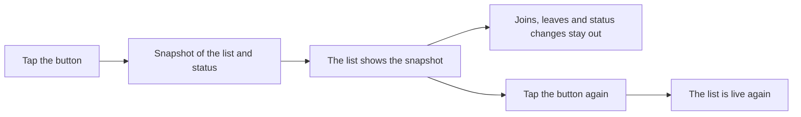

# ❄️ Freeze Member List

Freezes the member list of the open server. Each member's online or offline status and position stay as they were when you froze the list.

---

## 🧊 Why it exists

The member list in Discord reorders constantly as members join, leave and change status. On a phone, that makes it hard to find someone you are looking for. Freeze Member List takes a snapshot of the list and keeps it still until you unfreeze it.

## ✨ Usage

1. Open a server and wait for the member list to load.
2. Tap the floating **❄️** button.
3. The button turns blue and a **FROZEN** label appears.
4. Tap the button again to unfreeze the list.

Drag the button to move it. Its position is saved and survives screen rotation and app restarts.

| State | Button | Member list |
|---|---|---|
| Normal | ❄️ dark grey | Updates live |
| Frozen | ❄️ blue, with a **FROZEN** label | Stays on the snapshot |

## ⚙️ Settings

- **Show floating button**: shows or hides the button.
- **Reset button position**: moves the button back to its default position.
- **Freeze member list**: freezes or unfreezes the list without using the button.

If you enable the plugin while the app is already open, Valenced asks you to reload the app once so the button can appear.

## 🆘 Troubleshooting

If freezing doesn't work, the button shows a short hint:

| Hint | What to do |
|---|---|
| `Open a server first` | Open a server. |
| `Open the member list once first` | Open the member list of a channel and wait for it to load. |
| `Still starting, try again` | The plugin is still starting. Try again in a few seconds. |

## 🧠 How it works

Discord builds the member list from two sources: the structure of the list and the status of each member. When you freeze the list, the plugin keeps a copy of both and shows that copy. Nothing is blocked. The connection to Discord keeps running, and the app keeps receiving updates in the background. Only the display stays still.

<b>🔧 Technical details</b>

- The list structure comes from `ChannelMemberStore.getProps`. While frozen, it returns the stored copy.
- Status, mobile and VR flags, and activities come from `PresenceStore` getters. While frozen, they return the stored values only for members in the snapshot, only on the frozen server, and outside the member list update dispatch.
- The freeze state exists only in memory. Only the button's position and visibility are saved, through `jsonStorage`.
- All patches are registered with cleanup, so disabling the plugin restores the original behavior.
- The plugin makes no network requests of its own.

## ⚠️ Limitations

- **Only members already loaded are frozen.** Members who had not appeared in the list when you froze it stay hidden while the freeze is active, even if you scroll.
- **One server at a time.** Tapping the button while another server is frozen unfreezes the current one.
- **Restarting clears the freeze.** Closing and reopening Discord turns it off.
- **Frozen status also appears elsewhere on the same server**, for example in a member's profile.
- **Major Discord updates may require a plugin update**, because the plugin depends on internal app components.

## 🗂️ Project files

| File | Purpose |
|---|---|
| `manifest.json` | Plugin identity: ID, version, author and dependencies |
| `js/index.tsx` | Entry point: starts the freeze logic and the button |
| `js/freeze.ts` | Freeze logic: the snapshot of the list and of member status |
| `js/overlay.tsx` | Puts the button on top of the whole app |
| `js/button.tsx` | Floating button: tap, drag, colors and hints |
| `js/state.ts` | Saved settings (visibility, position) and runtime flags |
| `js/settings.tsx` | Settings screen |
| `js/snowflake.ts` | Snowflake icon |

## 🏷️ Plugin information

| Field | Value |
|---|---|
| ID | `axonyum.freeze-member-list` |
| Version | `1.0.1` |
| Type | JavaScript |
| Dependencies | `valenced.api` (`>=1 <2`), `discord` (any version) |

## 🙏 Credits

- Snowflake icon: Twemoji (`@discordapp/twemoji` 16.0.1, U+2744), licensed under [CC-BY 4.0](https://creativecommons.org/licenses/by/4.0/).

---

[⬅️ Back to repository](https://github.com/ApollyxnHashed/Valenced-Plugins)

