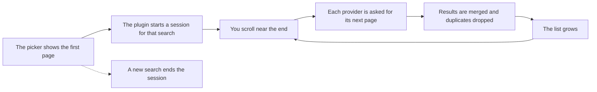

# ♾️ Infinite GIFs

Keeps loading new GIFs as you scroll the GIF picker, instead of stopping at the first page.

---

## 💡 Why it exists

The GIF picker in the Discord mobile app loads one page of results (50 GIFs) and stops. If the GIF you want is not in that first batch, you have to change your search and hope. Infinite GIFs keeps loading more results as you scroll.

## ✨ Usage

1. Open the GIF picker and search for a GIF, or open the trending GIFs.
2. Scroll down.
3. When you get close to the end of the list, the next batch loads and is added below.

There is nothing to configure and no settings screen. The plugin extends search results and trending GIFs. Favorites and categories stay as they are.

Each time you turn the plugin on, a short notice explains how it works with GIF Providers. Tap **Got it** to close it. The notice does not come back when Discord restarts.

### 📊 What to expect

| Setup | Where the GIFs come from | How far the list grows |
|---|---|---|
| Without GIF Providers | Discord's built-in provider (Klipy) | From 50 up to 100 GIFs per search |
| With GIF Providers | Tenor, Giphy and Klipy, as chosen in GIF Providers | Keeps growing as long as Tenor or Giphy have results |

> [!TIP]
> For the full infinite scroll, use Infinite GIFs together with the **GIF Providers** plugin. It is a separate plugin, made by Palm, Livie and Benjii.

## 🔌 Providers

| Provider | Used when | How it loads more |
|---|---|---|
| Klipy (Discord's built-in) | GIF Providers is not in use, or it has Klipy selected | Asks Discord's server for a longer list each time, up to 100 GIFs |
| Tenor | GIF Providers has Tenor selected | Continues from where the last request ended |
| Giphy | GIF Providers has Giphy selected | Continues from the number of GIFs already shown |

## 🧠 How it works

The plugin watches the GIF picker. When the picker shows the first page of a search or of the trending GIFs, the plugin starts a session for it. When you scroll within about a screen and a half of the end, it asks each provider for more GIFs, merges them and adds up to 50 at a time to the list.

The merge takes one GIF from each provider in turn, always in the same order, so a provider that answers faster cannot take over the list. Anything already on screen is skipped. A new search ends the session, and late answers from the previous search are thrown away.

<b>🔧 Technical details</b>

- The extra GIFs are kept in memory by the plugin, outside Discord's own GIF store, because the store does not accept a second success event for the same query.
- The list is extended by wrapping the `GIFPickerResultsList` component, with the lowest patch priority so other plugins' patches wrap ours.
- A session starts on the `GIF_PICKER_QUERY_SUCCESS` Flux event and ends on `GIF_PICKER_QUERY`, `GIF_PICKER_INITIALIZE` and `GIF_PICKER_QUERY_FAILURE`.
- Only the picker's own first page is extended. The check compares the length and the first and last ID, so favorites and categories are left alone.
- A GIF counts as already shown when its `id`, `url` or `src` was seen before.
- Language comes from `LocaleStore`, and the media format from `GIFPickerViewStore`.
- Tenor and Giphy are requested directly, with the same public API keys that GIF Providers ships. Klipy goes through Discord's own request function.
- GIF Providers' settings (selected providers and image quality) are read from its storage, read-only. The plugin never writes to another plugin's storage, and never creates a file there.
- Limits: batches of up to 50 GIFs, up to 6 requests per provider for each scroll, a 10 second timeout per request and a ceiling of 4,000 GIFs per search.
- Failures: a failed provider is retried after a growing delay (from 2 to 60 seconds, following `Retry-After` when the server sends it). One failing provider never blocks the others. While you stay at the end of the list, the plugin retries once per delay. A provider that fails 4 times in a row is skipped for the rest of that search, and one that returns nothing new 3 times in a row is treated as finished.
- Turning the plugin off cancels requests in progress, drops the extra GIFs, closes the notice and removes the patches.

## 🔒 Network

The plugin makes extra requests only to the providers that served the first page:

- Discord's own API, for Klipy.
- `api.tenor.com` and `api.giphy.com`, when GIF Providers is in use.

These requests carry your search text and your language setting, which they need to work. The plugin does not save them, send them anywhere else or collect anything.

## ⚠️ Limitations

- **Without GIF Providers, the list stops at 100 GIFs per search.** Discord's server does not return more than that.
- **Only search results and trending GIFs are extended.** Favorites and categories are not.
- **There is a ceiling of 4,000 GIFs per search.**
- **A provider that keeps failing is skipped for the rest of that search.** Start a new search to try it again.
- **Major updates may require a plugin update.** The plugin depends on internal Discord components (`GIFPickerResultsList`, `GIFPickerViewStore` and the `GIF_PICKER_*` events), and on the ID and settings format of GIF Providers.

## 🗂️ Project files

| File | Purpose |
|---|---|
| `manifest.json` | Plugin identity: ID, version, author and dependencies |
| `js/index.tsx` | Entry point: hooks the picker, starts and ends sessions, adds the extra GIFs to the list |
| `js/notice.tsx` | The notice shown when the plugin is turned on |
| `js/pagination/controller.ts` | Pagination logic: sessions, batches, retries and limits |
| `js/pagination/merge.ts` | Duplicate check and the round-robin merge |
| `js/pagination/types.ts` | Shared types: the GIF shape, the provider contract and the request error |
| `js/providers/factory.ts` | Picks which providers to use for each search |
| `js/providers/settings.ts` | Reads GIF Providers' settings (read-only) |
| `js/providers/shared.ts` | Shared helpers: requests, parsing and validation |
| `js/providers/klipy.ts` | Klipy loading: Discord's built-in provider |
| `js/providers/tenor.ts` | Tenor loading |
| `js/providers/giphy.ts` | Giphy loading |
| `tsconfig.json` | Type-checking configuration |

## 🏷️ Plugin information

| Field | Value |
|---|---|
| ID | `axonyum.infinite-gifs` |
| Version | `1.0.0` |
| Type | JavaScript |
| Dependencies | `valenced.api` (`>=1 <2`), `discord` (any version) |
| Works best with | GIF Providers (`dev.benjii.gif-providers`), optional |

## 🙏 Credits

- **GIF Providers**, by Palm, Livie and Benjii. Its multi-provider GIF search is what makes the endless list possible. Infinite GIFs follows its merge order and reads its settings.
- GIFs come from Klipy, Tenor and Giphy, through Discord's built-in picker or GIF Providers.

---

[⬅️ Back to repository](https://github.com/ApollyxnHashed/Valenced-Plugins)

