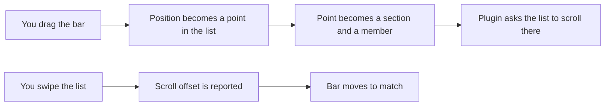

# ↕️ Member List Scroller

A draggable scroll handle for the member list, so you can jump through very long lists with your thumb.

---

## 💡 Why it exists

In a server with thousands of members, reaching the bottom of the member list means swiping again and again. Member List Scroller adds a thin handle at the right edge of the list. Touch it, drag it, and the list follows.

## ✨ Usage

Open the member list of a server, group or thread. A thin bar appears at the right edge.

| Action | What happens |
|---|---|
| **Swipe the list as usual** | The bar follows along, so it always shows where you are. |
| **Touch and drag the bar** | The list jumps proportionally: near the top shows the first members, near the bottom shows the last. |
| **While dragging** | The bar gets thicker and brighter, and a bubble shows the position, such as `823 / 2000`. |

The bar is slim and sits in the margin of the list, so it never covers names or avatars. It is hidden when the whole list already fits on the screen. It uses Discord's own theme colors, so it follows light and dark mode. There is nothing to configure.

## 🧠 How it works

<b>🔧 Technical details</b>

- The member list is a native virtualized list (`UsersFastList`). It only offers `scrollToTop` and `scrollToLocation(section, item)`, never a pixel offset, so the handle position is converted into a section and an item.
- The conversion uses the row and section header heights from Discord's own `useScaledRowHeight` and `useScaledSectionHeight` hooks (they grow with the font size), scaled to the content length the list reports.
- The list is replaced by a small host component through a JSX patch (`insteadJSX`). The host renders the original list unchanged and draws the bar beside it, over its right edge. All original props, refs and listeners keep working.
- The server list is recognized by its key (`guild-channel-user-list`). Group and thread lists are recognized by their props. Friends, search, share lists and lists inside action sheets are left alone.
- The list the host renders is marked, so the patch never wraps it again. A safety net also stops wrapping if a list ever re-renders in a loop.
- Only the bar captures touches (`PanResponder`), so opening profiles and normal swiping are unaffected.
- Turning the plugin off removes the patch and hides the bar.

## ⚠️ Limitations

- **The position can be off by a row or two** in lists with unusual row heights, because it is calculated from the list's layout.
- **Close and reopen the member list** after enabling the plugin, so it renders again.
- **Major updates may require a plugin update.** The plugin depends on internal Discord modules (`UsersFastList`, `useScaledRowHeight`, `useScaledSectionHeight`).

## 🗂️ Project files

| File | Purpose |
|---|---|
| `manifest.json` | Plugin identity: ID, version, author and dependencies |
| `js/index.tsx` | Plugin entry and the patch on the member list |
| `js/host.tsx` | Renders the list and the bar, and scrolls the list |
| `js/thumb.tsx` | The draggable bar and the position bubble |
| `js/match.ts` | Decides which lists get a bar, and never wraps the same list twice |
| `js/layout.ts` | Math that turns a position into a section and a member |
| `js/model.ts` | Scroll state shared between the list and the bar |
| `tsconfig.json` | Type-checking configuration |

## 📝 Changelog

- **1.0.1**: fixed a freeze when opening the group chat or direct message user view.
- **1.0.0**: first release.

## 🏷️ Plugin information

| Field | Value |
|---|---|
| ID | `axonyum.member-list-scroller` |
| Version | `1.0.1` |
| Type | JavaScript |
| Dependencies | `valenced.api` (`>=1 <2`), `discord` (any version) |

---

[⬅️ Back to repository](https://github.com/ApollyxnHashed/Valenced-Plugins)

