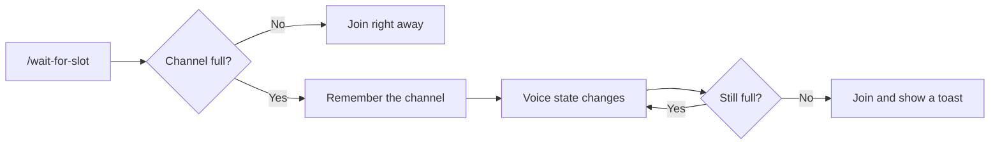

# 🎧 Wait for Slot

Joins a full voice channel for you the moment someone leaves and a slot opens.

---

## 💡 Why it exists

When a voice channel has a user limit and is full, Discord just refuses you. You end up tapping the channel again and again until someone leaves. Wait for Slot does the waiting for you and joins as soon as there is room.

## ✨ Usage

Two slash commands, available in any chat:

| Command | What it does |
|---|---|
| `/wait-for-slot channel:<voice channel>` | If the channel has room, you join right away. If it is full, the plugin waits and joins you the moment a slot opens. |
| `/stop-waiting` | Cancels the wait. |

Only one channel is awaited at a time. Waiting also ends on its own when you join the channel yourself or when the channel is deleted. A channel without a user limit has nothing to wait for. When the plugin joins you, a toast tells you which channel.

There is nothing to configure and no settings screen. Each time you turn the plugin on, a short notice explains the two commands. Tap **Got it** to close it. The notice does not come back when Discord restarts.

## 🧠 How it works

<b>🔧 Technical details</b>

- The commands are added to Discord's built-in command list by patching `getBuiltInCommands`, with ids below every other command so they never clash.
- Fullness is decided by Discord's own `isChannelFull` helper, with a plain user-limit check as a fallback.
- The plugin listens to `VoiceStateStore` changes and checks the awaited channel on each one.
- Joining uses Discord's own `selectVoiceChannel` action, the same call as tapping the channel.
- Nothing is stored and nothing leaves your device. Turning the plugin off clears the wait, closes the notice and removes the patch and the listener.

## ⚠️ Limitations

- **The channel must have a user limit.** Without one it is never full.
- **One channel at a time.** A new `/wait-for-slot` replaces the previous wait.
- **The wait is lost when Discord restarts.** Nothing is saved.
- **Major updates may require a plugin update.** The plugin depends on internal Discord modules (`getBuiltInCommands`, `isChannelFull`, `selectVoiceChannel`).

## 🗂️ Project files

| File | Purpose |
|---|---|
| `manifest.json` | Plugin identity: ID, version, author and dependencies |
| `js/index.ts` | Commands, the wait logic and the patch that adds the commands |
| `js/notice.tsx` | The notice shown when the plugin is turned on |
| `tsconfig.json` | Type-checking configuration |

## 🏷️ Plugin information

| Field | Value |
|---|---|
| ID | `axonyum.wait-for-slot` |
| Version | `1.0.0` |
| Type | JavaScript |
| Dependencies | `valenced.api` (`>=1 <2`), `discord` (any version) |

## 🙏 Credits

- The original **Wait For Slot** plugin for Unbound, by [adrian](https://unbound.rip/addons/unbound.wait-for-slot). This is a port to Valenced.

---

[⬅️ Back to repository](https://github.com/ApollyxnHashed/Valenced-Plugins)

